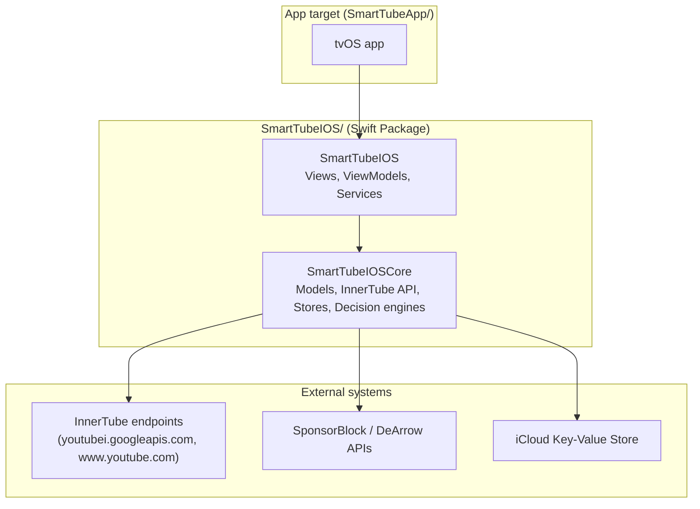

# Architecture overview

> How to update this doc: regenerate the module table's line counts with `just metrics`;
> update the target list whenever WS8 changes `Package.swift` targets. This doc describes
> the system as it is, not the target state — see `docs/modernization/PLAN.md` for that.

## Containers

tvOS is the only platform (ADR-0010). The `SmartTubeIOS` names are historical.

Dependency direction: `SmartTubeIOSCore` must never import `SmartTubeIOS`, SwiftUI, UIKit, AVFoundation, or WebKit (declared in `Package.swift`, **not currently enforced** — see `docs/modernization/AUDIT.md` §2.1). App targets depend on the package; the package never depends on an app target.

## Modules

| Module / area | Directory | Owner workstream | Notes |
|---|---|---|---|
| `SmartTubeIOSCore` | `SmartTubeIOS/Sources/SmartTubeIOSCore/` | WS6 (core hardening), WS3 (tests) | Should be Foundation-only; currently imports SwiftUI/AVFoundation/JavaScriptCore/Network too |
| `SmartTubeIOS` (views/view models/services) | `SmartTubeIOS/Sources/SmartTubeIOS/` | WS7 (UI/composition), WS4/WS5 (player) | |
| Playback (`PlaybackViewModel` + AVPlayer path) | `SmartTubeIOS/Sources/SmartTubeIOS/ViewModels/PlaybackViewModel*.swift` | WS4 (seams/pipeline), WS5 (session) | The critical path — see below |
| Stream resolution (JS extractors, descramblers) | `SmartTubeIOS/Sources/SmartTubeIOS/Services/YouTube*.swift` | WS4 | New `StreamResolver` target planned (WS8) |
| App target, composition root | `SmartTubeApp/Smart Tube/` | WS7, WS1 | |
| Tests | `SmartTubeIOS/Tests/`, `SmartTubeApp/UITests/` | WS3 | |
| Tooling / CI | repo root, `.github/`, `scripts/`, `justfile` | WS1 | |
| Docs / tasks | `docs/**`, `tasks/**` | WS2 | |

Full file-ownership-during-parallel-work table: `docs/modernization/PLAN.md` §4 (private repo, pending WS2-T2.6).

## Playback

The pipeline as it exists today (**legacy cascade** — pre-WS4; WS4 replaces the ordered-branch cascade with a `StreamSource`/`ResolutionPipeline` strangler fig, see `docs/modernization/workstreams/WS4-playback-seams-and-pipeline.md`):

1. `PlayerView.onAppear` → `PlaybackViewModel.load` → `loadAsync` → a primary HLS attempt with the InnerTube iOS client → `exhaustiveRetry` if that fails.
2. `exhaustiveRetry` (`PlaybackViewModel+Fallback.swift`) tries stream methods in a hand-written, ordered cascade. One race of paths runs concurrently; the InnerTube client list is written twice in different shapes (a `TaskGroup` and a serial loop) that must be kept in sync by hand.
3. Whichever path succeeds calls into the repeated `.readyToPlay` bookkeeping ritual (duration refresh, seek restore, load audio tracks, clear loading state, record timing) — one of the concrete duplication problems WS4 targets first.

Full evidence and line numbers: `docs/modernization/AUDIT.md` §2.2 (written before ADR-0010, so parts of it describe removed code).
