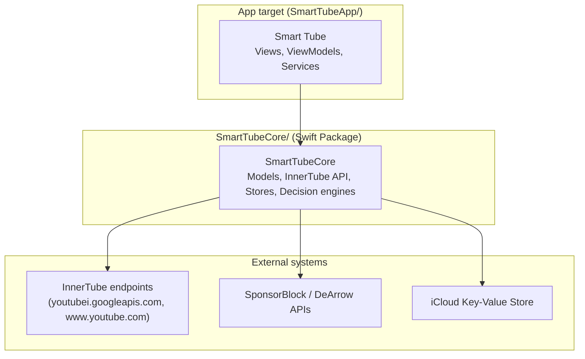

# Architecture overview

> How to update this doc: update the target list whenever WS8 changes `Package.swift` targets. This doc describes
> the system as it is, not the target state — see `docs/modernization/PLAN.md` for that.

## Containers

tvOS is the only platform (ADR-0010). ADR-0011 explains why there is one package.

Dependency direction: the app depends on `SmartTubeCore`. Core can't see app code, because the package boundary enforces that; it also must not import SwiftUI, UIKit or AVFoundation, which is a review rule.

## Modules

| Module / area | Directory | Owner workstream | Notes |
|---|---|---|---|
| `SmartTubeCore` | `SmartTubeCore/Sources/SmartTubeCore/` | WS6 (core hardening), WS3 (tests) | No UI or AVFoundation; also uses JavaScriptCore, Network, CryptoKit and Observation |
| App (views/view models/services) | `SmartTubeApp/Smart Tube/` | WS7 (UI/composition), WS4/WS5 (player) | |
| Playback (`PlaybackViewModel` + AVPlayer path) | `SmartTubeApp/Smart Tube/ViewModels/PlaybackViewModel*.swift` | WS4 (seams/pipeline), WS5 (session) | The critical path — see below |
| Stream resolution (JS extractors, descramblers) | `SmartTubeApp/Smart Tube/Services/YouTube*.swift` | WS4 | New `StreamResolver` target planned (WS8) |
| Composition root | `SmartTubeApp/Smart Tube/Smart_TubeApp.swift` | WS7, WS1 | |
| Tests | `SmartTubeCore/Tests/`, `SmartTubeApp/SmartTubeTests/`, `SmartTubeApp/UITests/` | WS3 | |
| Tooling / CI | repo root, `.github/`, `scripts/` | WS1 | |
| Docs / tasks | `docs/**`, `tasks/**` | WS2 | |

Full file-ownership-during-parallel-work table: `docs/modernization/PLAN.md` §4 (private repo, pending WS2-T2.6).

## Navigation

`MainTVTabView` (`Views/RootView.swift`) is a `.sidebarAdaptable` `TabView`. Top to bottom, the sidebar shows the account header, Search, Home, Subscriptions, Library, Settings, then a Channels section sorted alphabetically (`SidebarChannelsViewModel`).

`AppNavigator` holds the selected tab, one `[AppRoute]` path per tab, and the player presentation. Channels and playlists are pushed routes. The player, which is the system `AVPlayerViewController` (ADR-0014), is one `fullScreenCover` on the `TabView`, so they aren't tab content. Opening a channel from the player closes it and pushes the channel onto the current tab. See ADR-0012.

`AppFeeds` owns the view models of pages reached from the sidebar, because the `TabView` discards a tab's `@State` when another tab is selected. Loaded pages stay as they are for `FeedFreshness.refreshInterval`; after that they refresh while keeping their content on screen.

## Playback

The pipeline as it exists today (**legacy cascade** — pre-WS4; WS4 replaces the ordered-branch cascade with a `StreamSource`/`ResolutionPipeline` strangler fig, see `docs/modernization/workstreams/WS4-playback-seams-and-pipeline.md`):

1. `PlayerView.onAppear` → `PlaybackViewModel.load` → `loadAsync` → a primary HLS attempt with the InnerTube iOS client → `exhaustiveRetry` if that fails.
2. `exhaustiveRetry` (`PlaybackViewModel+Fallback.swift`) tries stream methods in a hand-written, ordered cascade. One race of paths runs concurrently; the InnerTube client list is written twice in different shapes (a `TaskGroup` and a serial loop) that must be kept in sync by hand.
3. Whichever path succeeds calls into the repeated `.readyToPlay` bookkeeping ritual (duration refresh, seek restore, load audio tracks, clear loading state, record timing) — one of the concrete duplication problems WS4 targets first.

Full evidence and line numbers: `docs/modernization/AUDIT.md` §2.2 (written before ADR-0010, so parts of it describe removed code).
